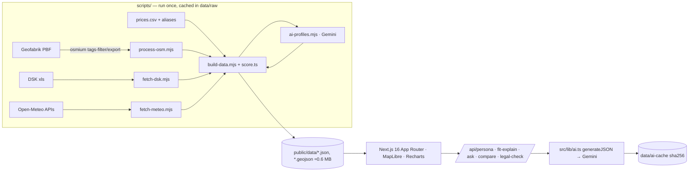

# Məskən — harada yaşamalı, rəqəmlərlə

**Məskən** is a 2D data map of Azerbaijan for people buying a flat, a courtyard house, commercial property or land. Every rayon/city (75) and every Baku district (12) is a coloured region. Click one to see prices, services, transport, roads, nature and density as charts. An AI analyst explains the area. Describe your life in one sentence and the whole map recolours by how well each area fits *you*.

**Live demo:** _<Vercel URL>_ · **UI language:** Azerbaijani · **AI:** Google Gemini (flash models, free tier)

---

## 1. Problem

> *Ev alan insan 3 şeyi bilmir: hansı ərazi ona uyğundur, evin real qiyməti nədir, alışda hüquqi risk nədir.*
> (A home buyer doesn't know three things: which area suits them, what the real price is, and what the legal risk is.)

- **Which area fits me?** Listing sites show flats, not neighbourhoods. Within Baku, the price per m² differs **more than 2.8×** between districts: Səbail averages 4,132 ₼/m² and Pirallahı 1,452 ₼/m² ([Caliber.az, 30.09.2026](https://caliber.az/en/post/a-metre-at-a-premium-why-are-property-prices-rising-in-baku)). Nobody shows what you get for that difference: schools, metro, paved roads, clean air.
- **What is the real price?** Housing prices rose 8.6% year-on-year in Q2 2026, and new builds rose 12.4%, while wages rose about 7% ([JAM News citing the Central Bank of Azerbaijan, 31.08.2026](https://jam-news.net/salaries-rise-7-while-house-prices-climb-12-4-is-it-worth-buying-home-in-azerbaijan/)). A cheaper flat far from work can cost more over 10 years once commuting is counted.
- **What is the legal risk?** Listings routinely say *"kupça hazırlanır"*, *"müqavilə ilə"*, *"çıxarışsız"* or *"etibarnamə ilə"*. These phrases signal missing ownership documents, and most buyers don't know what they mean.

_User interviews:_ `<!-- TODO: add 2–3 real quotes from buyers we talked to -->`

## 2. Solution

| Map + panel | Persona → personal fit | AI analyst + tools |
|---|---|---|
|  |  |  |

1. **Choropleth map** at two levels (Azerbaijan by rayon, Baku by district). Eight metrics: fit, flat price, density, services, transport, paved roads, nature, air (PM2.5). The colours sweep west→east when the metric changes.
2. **Region panel** with KPI tiles and six tabs: prices by property type, services per 10k residents vs median, transport (metro, rail, stops, routes, route numbers), road surface, nature (land cover, elevation, climate, PM2.5 vs the WHO limit), and the area's "DNA" radar with "similar but cheaper" areas.
3. **AI Analitik**: a category, headline, strengths and weaknesses (each with the metric behind it), who it suits, and what to watch out for. There is also an "ask about this area" box.
4. **Persona**: "2 uşaqlı ailəyik, büdcəmiz 150 min, işim Nəsimidədir" becomes weights, budget, work hub and transport mode. The map recolours by fit, shows a TOP-5, and gives a "Sənin üçün" explanation.
5. **Tools**: a 10-year true cost (price plus the commute's money and time), a legal check of a pasted listing, and a business-gap finder.
6. **`/muqayise`** compares 2–3 areas with an AI verdict. **`/menbeler`** lists every dataset, date, coverage figure and limitation, plus which prices are real and which are demo values.

## 3. What the AI does (and why an LLM is needed)

| # | Feature | Why it needs an LLM |
|---|---|---|
| 1 | **Area profiles** (87, precomputed) | Turns ~60 numbers into a readable verdict and assigns category tags. The reasoning differs by area; a template can't weigh "few schools but 6 metro stations". |
| 2 | **Persona → weights** | Free Azerbaijani text ("təqaüdçüyəm, sakit yer") must become a structured search (property type, budget, hub, mode, 7 weights). |
| 3 | **"Sənin üçün"** | Explains *this* fit score for *this* person, including the trade-offs. |
| 4 | **Ask about an area** | Open questions, answered only from the area's JSON; it says when the data can't answer. |
| 5 | **Compare** | Synthesises 2–3 multi-dimensional profiles into "who should pick which". |
| 6 | **Legal check** | Reads informal listing language and maps it to risks and a document checklist. Known risk phrases are also caught by a deterministic detector, so they're never missed. |

**Grounding rules** (in every prompt): use only numbers from the provided JSON. Say when OSM coverage is low or a price is a demo value. Cite law articles only if their text is in `data/legal/`. Make no promises about future prices. All outputs are JSON-schema constrained (`responseJsonSchema`), validated with zod and retried once on a validation error. Results are cached by sha256 of the input. On a rate limit or outage the app falls back to clearly labelled rule-based text.

**Provider:** Google Gemini via `@google/genai`. The default model is `gemini-3.7-flash`, with automatic fallback to other flash models on 429/503 (`gemini-2.5-flash` is closed to new API keys). Every call goes through one wrapper: `src/lib/ai.ts → generateJSON(prompt, zodSchema)`.

## 4. Data & transparency

Every number in the UI carries a badge: **Canlı (OSM)**, **Rəsmi (DSK)**, **Hesablanıb** (computed), **Mətbuat** (published estimate), **Nümunə** (sample), **Demo**, **Model**.

| Dataset | Source | Type | Coverage |
|---|---|---|---|
| Boundaries, POIs, stops, metro, routes, roads, land cover, coastline | OpenStreetMap, [Geofabrik extract](https://download.geofabrik.de/asia/azerbaijan-latest.osm.pbf), processed with osmium | Live (OSM) | 75 rayons + 12 Baku districts. POI coverage per area: 35 high / 24 medium / 16 low |
| Population (01.01.2026), area, density | [DSK table 1.15](https://www.stat.gov.az/source/demoqraphy/az/001_15.xls) | Official | 87/87 |
| Elevation (5×5 grid), terrain class | Open-Meteo Elevation API | Computed | 87/87 |
| Climate 2025 (July max, January min, precipitation) | Open-Meteo / ERA5 | Model | 87/87 |
| PM2.5, last 30 days | Open-Meteo / CAMS | Model | 87/87 |
| Prices (5 property types) | `data/manual/prices.csv`: 7 published figures (Caliber.az, JAM News/Chamber of Appraisers, Cyril Jarnias) + 88 demo values | Press estimate / **Demo** | 12 Baku districts + 7 cities |
| Legal texts | e-qanun.az (`data/legal/`) | Official | Empty → AI gives a checklist without article numbers |

**Limitations**
- **Most prices are demo values.** There is no open official price-by-district statistic, and we don't scrape listing sites (bina.az, tap.az). The demo values are consistent with the published anchors (centre > suburbs, new > old, regions < Baku) and are always badged "Demo". Replacing the CSV updates everything with no code changes.
- OSM is incomplete outside big cities: a low count can mean "not mapped" rather than "doesn't exist". The UI and the AI both state the coverage level.
- Bus routes reflect only what's mapped in OSM. Road surface is unknown for many roads; "paved %" uses only roads with a known surface.
- PM2.5 and climate are model values at the area's centroid, not measurements.
- There is no traffic or real travel-time data. Yandex/Waze are listed as future partnerships.

## 5. Methodology

- **Areas**: OSM `boundary=administrative` (admin_level 6 for rayons; Baku districts at levels 6–8). Polygons are clipped to land using the Caspian coastline, with islands kept. Baku at country level is the union of its 12 districts.
- **Indices (0–100)**: each metric is converted to a percentile rank among areas of the same level, and each index is the mean of its metrics.
  - *rahatlıq*: grocery, pharmacy, food, mall, bank per 10k
  - *nəqliyyat*: stops per 10k, routes, metro, inverse distance to metro
  - *təhsil*: schools, kindergartens, universities per 10k
  - *səhiyyə*: hospitals, clinics, pharmacies per 10k
  - *təbiət*: forest + water + grass + park share, inverse PM2.5, +10 if coastal
  - *infrastruktur*: paved share, inverse unpaved share
  - *əlçatanlıq*: inverse price
- **Fit** = Σ(w·index)/Σw, plus a commute term (weight 0.8, distance to the work hub's centroid). If price × m² exceeds the budget, fit is multiplied by 0.3 and labelled "büdcədən baha".
- **Similar but cheaper**: cosine similarity of the 6 non-price indices, keeping only cheaper areas, top 3.
- **True cost (10 years)** = price × m² + 120 × (monthly transport + commute hours × hourly value). Distance = straight line × 1.4; speeds are metro 30, bus 15, car 25 (Baku) / 60 (intercity) km/h. Labelled "təxmini model".
- **Business gap**: residents per facility vs the median of the level. Flagged if the ratio is > 1.5 and population is > 10k.
- **Land cover**: a 30×30 (districts) or 36×36 (rayons) sample grid per area, intersected with OSM land-use polygons through a spatial grid index.

## 6. Architecture



The app reads only `public/data`. There are no external map tiles: regions are GeoJSON polygons on a plain background.

## 7. Business model

- **B2C: free** map, persona fit and basic legal check.
- **B2B realtors and developers**: qualified leads (the persona plus the areas a user selected), and area reports for listings and new projects.
- **Banks**: mortgage risk and demand by area; "ipotekaya yararlı" checks.
- **Premium legal check** with partner lawyers and notaries (document review per transaction).
- **Municipalities and executive authorities**: service-gap reports (residents per school, clinic or pharmacy by area).

## 8. Roadmap

1. Price-data partnerships (banks, appraisers' chamber, portals via official APIs) to replace the demo values.
2. Google Places enrichment for the selected area (keys already supported via `GOOGLE_MAPS_API_KEY`).
3. Waze for Cities / Yandex traffic partnership for real commute times.
4. Full price coverage for all 75 rayons; settlement-level detail inside Abşeron.
5. Legal corpus from e-qanun.az with article-level citations.
6. Mobile app, saved searches and alerts.

## 9. Run locally

```bash
npm install
cp .env.example .env.local   # add GEMINI_API_KEY
npm run dev                  # http://localhost:3000
```

Rebuild the data (optional; outputs are committed in `public/data`):

```bash
brew install osmium-tool
curl -L -o data/raw/azerbaijan-latest.osm.pbf https://download.geofabrik.de/asia/azerbaijan-latest.osm.pbf
npm run data:osm && npm run data:dsk && npm run data:meteo && npm run data:build
npm run data:ai && npm run data:build   # Gemini area profiles (resumable)
npm run check                            # zod data validation + next build
```

**Team:** _<names, roles>_ · Built for the hackathon, October 2026.
