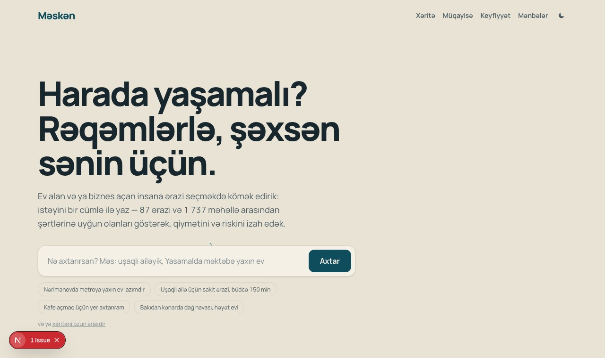
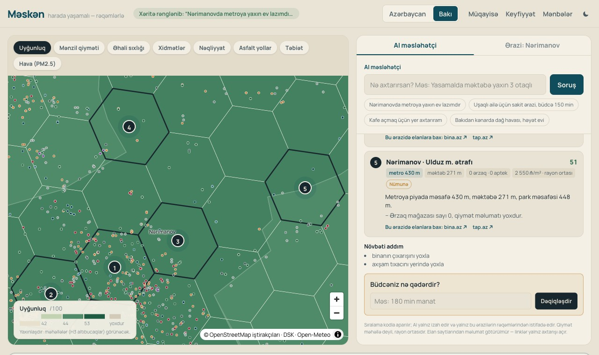
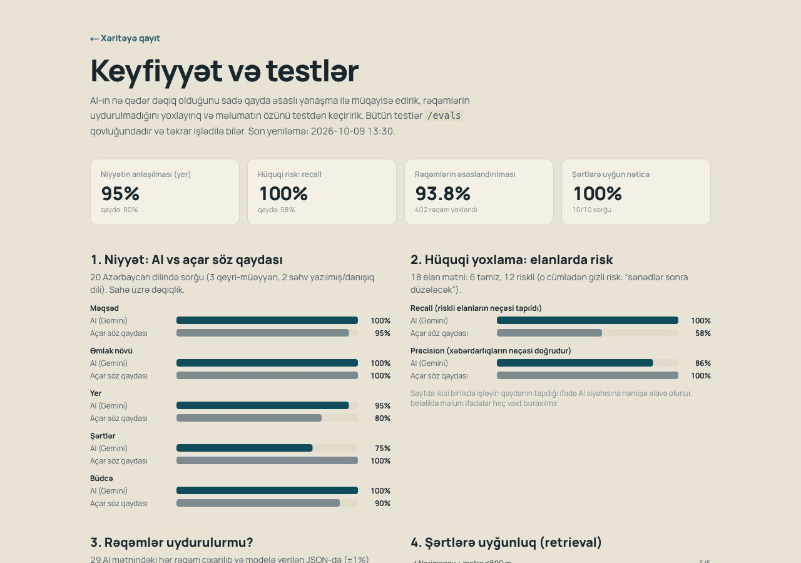
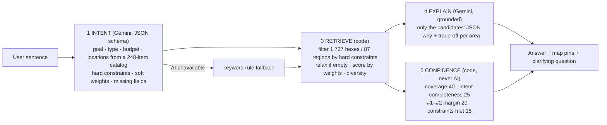
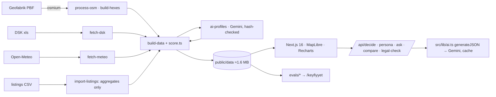

# Məskən — harada yaşamalı, rəqəmlərlə

**Məskən** helps a home buyer in Azerbaijan pick an *area*, not just a flat. You write one sentence ("Nərimanovda metroya yaxın ev lazımdır"). An AI decision engine turns it into constraints. Deterministic code then ranks 87 regions and **1,737 micro-areas** (H3 hexes) against them, and AI explains each recommendation with real numbers. A confidence score, computed by code rather than the model, says how much to trust the answer.

**Live demo:** https://meskan-seven.vercel.app (app: [/xerite](https://meskan-seven.vercel.app/xerite), tests: [/keyfiyyet](https://meskan-seven.vercel.app/keyfiyyet)) · **UI language:** Azerbaijani · **AI:** Google Gemini (flash models, free tier) · **Tests:** [`/keyfiyyet`](#3-quality-testing)

| Landing: one sentence in | Decision engine: 5 micro-areas, confidence, map pins | Quality tests on `/keyfiyyet` |
|---|---|---|
|  |  |  |

---

## 1. Value for the user

**Who:** a first-time buyer family in Baku (two adults and a child, budget ~150–200k ₼, one parent commuting).
**Outcome:** a shortlist of 5 concrete micro-areas in about 2 minutes, each with metro walking distance, the nearest school and kindergarten, a price and its source, plus a legal-risk check of the listing they are about to call.

**Why this is needed (sourced):**

| Figure | Source |
|---|---|
| New-build prices **+12.4%** y/y (Q2 2026); all housing +8.6% | Central Bank review via [JAM News, 31.08.2026](https://jam-news.net/salaries-rise-7-while-house-prices-climb-12-4-is-it-worth-buying-home-in-azerbaijan/) |
| Wages **+7%**, so prices outpace income | same |
| **2.8×** price gap between Baku districts (Səbail 4,132 ₼/m², Pirallahı 1,452 ₼/m²) | [Caliber.az, 30.09.2026](https://caliber.az/en/post/a-metre-at-a-premium-why-are-property-prices-rising-in-baku) |
| **21%** of 100,436 Baku listings state "Çıxarış: yoxdur" (no property deed) | bina.az listings dataset, Oct–Nov 2024 (aggregated by us, see §4) |

The three questions a buyer can't answer today: *Which area suits me? What is the real price? Is there a legal risk?* Listing sites show flats, maps show places, and nobody joins them up for a decision.

_User interviews / timing test:_ `<!-- TODO: 3 participants, manual bina.az + Google Maps vs Məskən, minutes + quotes (template on /keyfiyyet) -->`

## 2. Prototype & AI

**Core scenario:** "Nərimanovda metroya yaxın ev lazımdır" → 5 micro-areas around Nəriman Nərimanov, Gənclik, Bakmil and other stations. Each shows walking distance to the metro (e.g. 540 m), school distance, the count of groceries and pharmacies, the price per m² with its badge, a trade-off, and "bina.az / tap.az" search links. Confidence is 60/100 ("orta"), with a breakdown. The answer ends with one clarifying question: *"Büdcən nə qədərdir?"* The map flies to the 5 numbered, pulsing pins.

### Decision-engine pipeline (`/api/decide`)



**What the AI adds over a rule baseline (measured, see §3):** it resolves place names with typos and slang ("nerimanovda kiraye") and catches *implicit* legal risk ("sənədlər sonra düzələcək"): **100% recall vs 58%** for keyword rules. The LLM never ranks and never computes the confidence score. Ranking is reproducible code, which keeps the AI honest.

Other AI features: precomputed area profiles for 87 regions (quality-gated, regenerated automatically when the data changes), a legal check of pasted listings, 2–3-area comparison, and "Sənin üçün" fit explanations.

**Data features:** a choropleth map at two levels (8 metrics), H3 micro-area layer, region panel with 6 chart tabs (prices, services per 10k vs median, transport, road surface, nature and climate, a 7-index radar plus "similar but cheaper"), 10-year true-cost calculator (price + commute money and time), and a business-gap finder.

## 3. Quality testing

All tests live in [`/evals`](evals), write `public/data/evals.json`, and are shown on **`/keyfiyyet`**. Gemini runs on the free tier, sequentially, and cached cases are never re-run.

| Eval | What | Result |
|---|---|---|
| **Intent** (20 Azerbaijani queries, incl. 3 vague and 2 slang/typo) | per-field accuracy, AI vs keyword rules | location **95% vs 80%**, budget **100% vs 90%**, goal 100 vs 95, property type 100 vs 100, constraints 75 vs 100* |
| **Legal check** (18 listings: 6 clean, 12 risky incl. implicit) | precision / recall | AI **P 86% / R 100%** · rules P 100% / R 58% |
| **Grounding** (30 AI texts, 402 numbers) | every number must exist (±1%) in the input JSON | **93.8%** grounded; the 6.2% miss was traced to stale profiles (fixed below) |
| **Retrieval** (10 queries with hard constraints) | 100% of returned areas satisfy them | **10/10** |
| **Data sanity** (14 checks) | completeness, NaN, plausibility, metro vs official list, outliers | **14/14** |

\* The rule baseline scores 100% on constraints because the labels were written with the same keywords. The AI's errors were missing `coastal` for "dənizə yaxın" (the prompt has since been tightened).

**Failure analysis (5 real bugs, input → wrong output → cause → fix):**
1. **Xankəndi topped every ranking.** The 409 OSM POIs are mapped for the pre-2023 city (~55k residents), but DSK 2026 counts 4,400. That gives 47.7× the median per capita, so every index hit 99. **Fix:** a generic rule (>10× median ⇒ per-capita values become null, with a warning) and a data-sanity guard.
2. **A non-existent metro station was recommended** ("20 Sentyabr"). OSM tags depots, exits and planned stations as `station=subway` (33 vs 27 real). **Fix:** validate against the 27-station list.
3. **Stale AI numbers (6.2% ungrounded).** Profiles were written before fix #1 changed the percentiles. **Fix:** an input hash per profile, so changed data triggers regeneration.
4. **NaN confidence.** Operator precedence (`s + x ?? 0`). Fixed.
5. **Fallback model dropped Azerbaijani letters.** **Fix:** a profile quality gate (length, ≥6 numbers, forbidden generic phrases, ə/ğ/ı/ş present).

## 4. Feasibility

| Data | Status | Source | Needed for production |
|---|---|---|---|
| Boundaries, POIs, metro, stops, routes, roads, land cover | **real** | OpenStreetMap (Geofabrik, osmium) | monthly refresh job |
| Population 01.01.2026 | **official** | DSK table 1.15 | yearly |
| Elevation, climate 2025, PM2.5 (model) | **real / model** | Open-Meteo (Copernicus DEM, ERA5, CAMS) | none |
| Prices | **61 real** (54 sample medians from 95,632 listings + 7 published figures) · **40 demo** | bina.az listings dataset (Oct–Nov 2024; supplied by the user, collected by a third party; **we don't scrape**, only aggregates are stored) + press | price-data partnership (portal API, banks, Chamber of Appraisers) |
| Metro validation | real | 27 operating stations (Wikipedia list; metro.gov.az unreachable) | official GTFS |
| Legal texts | not yet | e-qanun.az | lawyer-reviewed corpus |

**Running cost (measured):** on average **2,027 input + 386 output tokens per AI call** (37 calls measured). A session of ~4 calls (decide = intent + explain, a follow-up, a legal check) costs **$0.006** at gemini-3.7-flash list prices (third-party tracker; $0.375 / $1.88 per 1M) to **$0.026** at the conservative 3.5-flash price ($1.50 / $9). That is **$6–26 per 1,000 users**. The free Gemini tier covers the demo, and the sha256 cache makes repeated questions free. Hosting is free (Vercel; data is static, ~1.6 MB).

**Limitations:** most rayons have no price; OSM is thin outside cities (16 of 87 areas have low coverage, shown in the UI); hex prices come from 2024 listings (+8–12%/yr since); commute times are straight-line × 1.4 with no traffic; PM2.5 is a model value.

**Next step:** a 4-week pilot with one Baku realtor (lead form + area report), a listing-data partnership to replace demo prices, and a monthly OSM refresh with the sanity evals as a gate.

**Business model:** free for buyers; B2B area reports and qualified leads for realtors and developers; mortgage-by-area analytics for banks; a premium legal check with partner notaries; service-gap reports for municipalities.

## 5. Originality

- **Decision engine, not a chatbot.** AI parses intent and explains, code ranks, and **code computes confidence** with a visible breakdown. No other tool here joins neighbourhood-level metrics to a buyer's sentence.
- **Micro-areas.** H3 hexes labelled with human names ("Nərimanov · Gənclik m. ətrafı"), with walking distance to a validated metro station and hex-level price medians where at least 5 listings exist.
- **Legal check of listing language**, AI plus a deterministic detector, so known risk phrases are never missed.
- **True cost** over 10 years: a cheap flat far from work can cost more.
- **Data honesty as a feature:** every number has a badge (Canlı OSM, Rəsmi DSK, Nümunə, Mətbuat, Demo, Model), and we publish our own failures.

## Architecture & run locally



```bash
npm install
cp .env.example .env.local   # GEMINI_API_KEY
npm run dev                  # http://localhost:3000  (app: /xerite)
npm run check                # data-sanity + zod + next build
node --dns-result-order=ipv4first evals/run-evals.mjs all && node evals/build.mjs
```

**Team:** _<names, roles>_ · Hackathon, October 2026.
